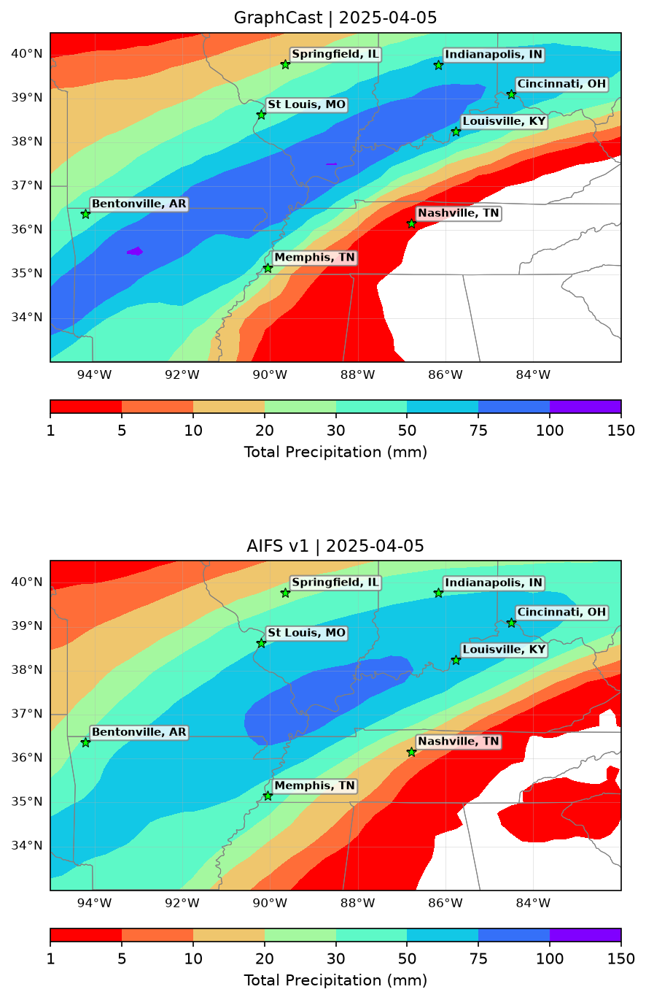
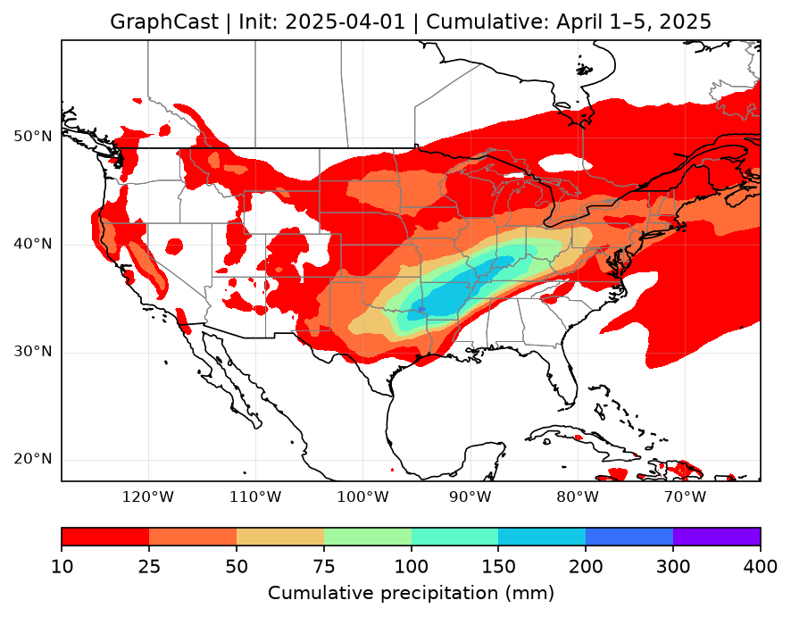
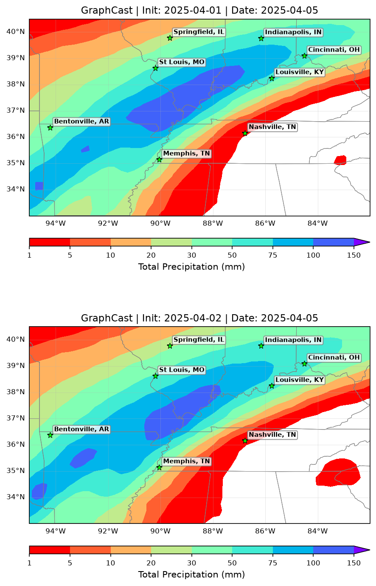
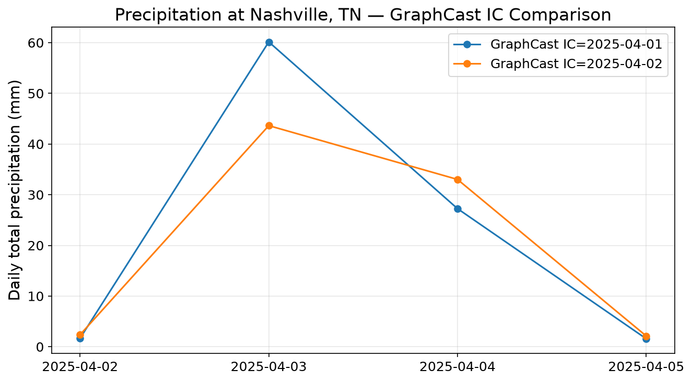

# Flood Forecasts — 2025 Tennessee Valley Flood



In early April 2025, days of repeated heavy rain flooded the Ohio and Tennessee valleys. Two AI weather models, Google DeepMind's GraphCast Operational and ECMWF's AIFS v1, forecast the event in deterministic runs started on 1 April (GraphCast also from 2 April), using [NVIDIA Earth2Studio](https://github.com/NVIDIA/earth2studio). Their daily and cumulative precipitation is mapped, compared across initial conditions and between the two models, and scored against ERA5 daily precipitation.

## Results at a glance

Scores compare each forecast with ERA5 daily precipitation over the Tennessee Valley box (33–40.5°N, 95–82°W). ERA5 precipitation is itself model-derived, so these numbers measure agreement with ERA5, not with rain gauges. Bias is forecast minus ERA5 in mm/day; Pattern corr is the spatial correlation of the daily rainfall pattern.

**GraphCast, 1–5 April** (last row: 1–5 April total, mm)

<!-- graphcast_tennessee_valley_flood_metrics:START -->
_Filled in after the verified run._
<!-- graphcast_tennessee_valley_flood_metrics:END -->

**Initial-condition comparison (mean over Apr 2–5)**

<!-- graphcast_tennessee_valley_flood_ic_compare_metrics:START -->
_Filled in after the verified run._
<!-- graphcast_tennessee_valley_flood_ic_compare_metrics:END -->

**GraphCast vs AIFS (mean over Apr 2–5)**

<!-- tennessee_valley_flood_model_comparison_metrics:START -->
_Filled in after the verified run._
<!-- tennessee_valley_flood_model_comparison_metrics:END -->



*Cumulative rain: GraphCast's 1–5 April total from the 1 April GFS start.*



*Initial-condition sensitivity: GraphCast's 5 April forecast started on 1 April (top) and on 2 April (bottom).*



*Nashville: daily totals from the two GraphCast runs, 2–5 April.*

## Models and data

| Model | Developer | Initial condition | Used in |
|---|---|---|---|
| GraphCast Operational | Google DeepMind | NOAA GFS analysis; ERA5 via ARCO in the model comparison | all three notebooks |
| AIFS v1 (AIFS Single, `aifs-single-1.1` checkpoint) | ECMWF | ERA5 via ARCO | model comparison |
| ERA5 | ECMWF reanalysis (Copernicus Climate Data Store) | — | reference for the daily precipitation scores |

## Quick start

Requires Python 3.12, [uv](https://docs.astral.sh/uv/), and an NVIDIA GPU with about 48 GB of VRAM (developed and tested on an L40).

```bash
git clone https://github.com/ChristianByars/Flood-Forecasts.git
cd Flood-Forecasts
uv sync
uv run python -m ipykernel install --user --name flood-forecasts --display-name "flood-forecasts"
```

`uv sync` expects a prebuilt flash-attn wheel in a git-ignored `wheels/` folder at the repo root (see [Prebuilt flash-attn wheel](docs/environment.md#known-issues-and-fixes)).

Open a notebook in JupyterLab and select the **flood-forecasts** kernel, then run all cells. The ERA5 verification cells also need a Copernicus Climate Data Store API key in `~/.cdsapirc` (see [docs/environment.md](docs/environment.md)).

## Notebooks

<!-- RUNS:START -->
_Runtime and GPU memory are filled in after the verified run._
<!-- RUNS:END -->

| Notebook | Event | Init date (00Z) | Forecast window |
|---|---|---|---|
| `graphcast_tennessee_valley_flood.ipynb` | 2025 Tennessee Valley Flood — GraphCast | 2025-04-01 (GFS) | Apr 1–5 (to Apr 6 00Z), scored over Apr 1–5 |
| `graphcast_tennessee_valley_flood_ic_compare.ipynb` | 2025 Tennessee Valley Flood — IC comparison | 2025-04-01 & 2025-04-02 (GFS) | to Apr 7 00Z, compared and scored over Apr 2–5 |
| `tennessee_valley_flood_model_comparison.ipynb` | 2025 Tennessee Valley Flood — GraphCast vs. AIFS v1 | 2025-04-01 (ERA5/ARCO, shared IC) | Apr 1–5 (to Apr 6 00Z), compared and scored over Apr 2–5 |

## Repository layout

```text
graphcast_tennessee_valley_flood.ipynb             GraphCast from GFS: daily and cumulative maps, ERA5 scores
graphcast_tennessee_valley_flood_ic_compare.ipynb  GraphCast from two GFS initial conditions, ERA5 scores
tennessee_valley_flood_model_comparison.ipynb      GraphCast vs AIFS v1 from the same ERA5 state, ERA5 scores
metrics.py                                         area-weighted bias, RMSE, MAE and pattern correlation
era5_truth.py                                      ERA5 daily precipitation: download, day alignment, box crop
tests/                                             unit tests for metrics.py and era5_truth.py
docs/images/                                       figures shown in this README
docs/results/                                      CSV metric tables written by the notebooks
docs/environment.md                                pinned versions and install notes
tn_*_outputs/, aifs_tn_flood_outputs/              forecast Zarr stores and PNGs (git-ignored, made by the notebooks)
```

## Environment notes

Pinned versions, install caveats, and fixes are in [docs/environment.md](docs/environment.md).

## References

- [NVIDIA Earth2Studio](https://github.com/NVIDIA/earth2studio) and its [documentation](https://nvidia.github.io/earth2studio/)
- GraphCast: Lam et al. (2023), "Learning skillful medium-range global weather forecasting", *Science*, [doi:10.1126/science.adi2336](https://doi.org/10.1126/science.adi2336)
- AIFS: Lang et al. (2024), "AIFS – ECMWF's data-driven forecasting system", [arXiv:2406.01465](https://arxiv.org/abs/2406.01465)
- ERA5: Hersbach et al. (2020), "The ERA5 global reanalysis", *Q. J. R. Meteorol. Soc.*, [doi:10.1002/qj.3803](https://doi.org/10.1002/qj.3803); hourly single-level data on the [Copernicus Climate Data Store](https://cds.climate.copernicus.eu/datasets/reanalysis-era5-single-levels)
- [uv](https://docs.astral.sh/uv/)
